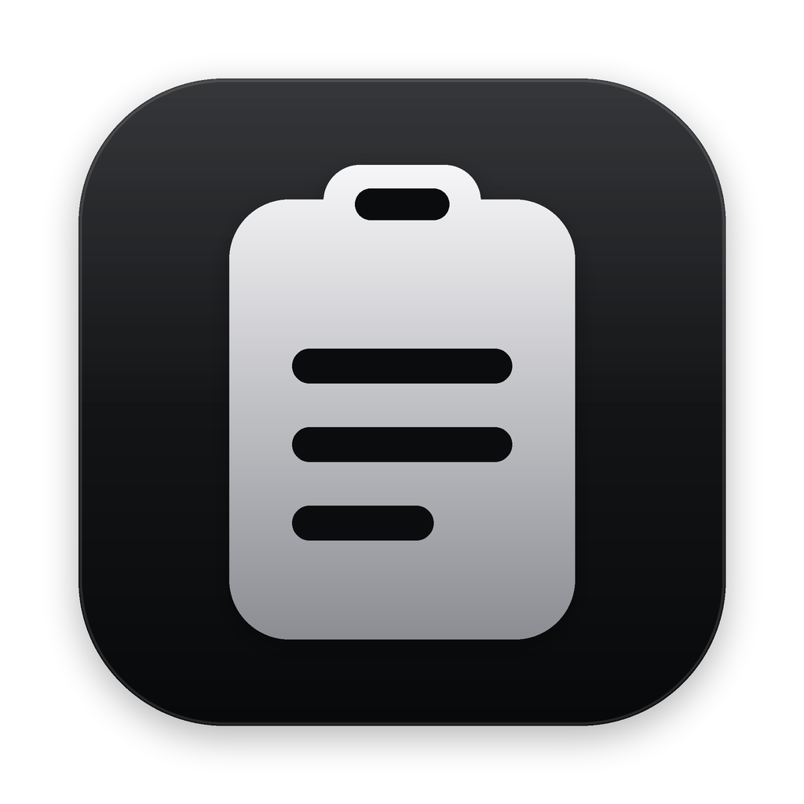
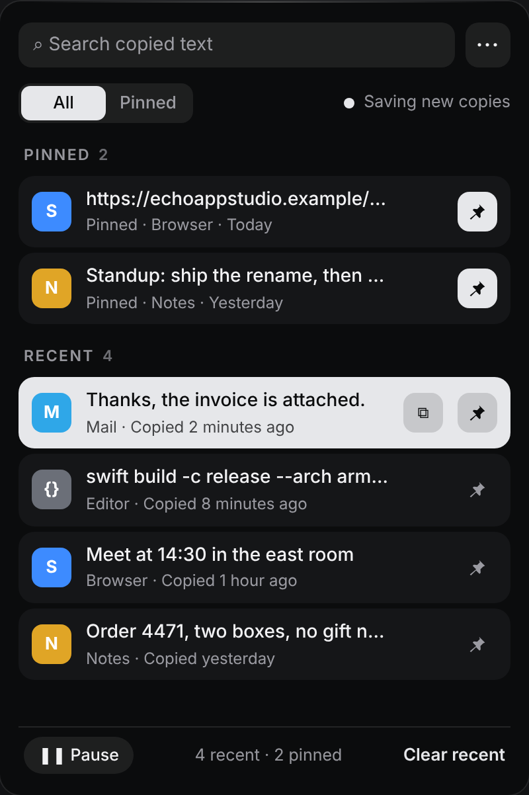

<p align="center">
  
</p>

<h1 align="center">EchoLena</h1>

<p align="center">A quiet macOS menu-bar clipboard history with search, pins, and a pause switch.</p>

<p align="center"><a href="https://github.com/echoappstudio/EchoLena/releases/latest"><strong>Download the latest release</strong></a> · macOS 26+ · Apple silicon and Intel</p>

<p align="center">
  <a href="https://github.com/echoappstudio/EchoLena/releases/latest"></a>
  
  <a href="https://github.com/echoappstudio/EchoLena/actions/workflows/macos-ci.yml"></a>
  <a href="LICENSE"></a>
</p>

<p align="center"></p>

## Features

- **Everything you copy, one click away.** Click the clipboard icon in the menu bar to see the text you've copied recently, newest first, with how long ago you copied it ("Copied 8 minutes ago"). Click an item to copy it again.
- **Pin what you reuse.** Pinned items sit at the top with a filled pin button and never fall off the list. Switch between **All** and **Pinned**.
- **See where it came from.** Each new copy shows the icon and name of the app you copied it from. It's on by default; **⋯ → Show Source App Icons** turns it off.
- **Black and silver, or a colour.** EchoLena starts in **Signature**, a black, charcoal and silver look. Choose Sky, Green, Turquoise, Bordeaux or Wisteria from **⋯ → Skin**, and Light, Dark or Automatic from **⋯ → Appearance**. The app's icon in Finder and Launchpad changes colour with the skin; **⋯ → App Icon Follows Skin** turns that off.
- **Search as you type** through everything on the shelf.
- **Keep 20, 50 or 100 recent items**, chosen from the ⋯ menu. Pins don't count toward the limit.
- **Pause anytime.** The Pause button stops saving new copies (the menu-bar icon changes so you can tell), and **Clear recent** empties the list while keeping your pins.
- **Private by design.** Items marked as concealed, temporary or auto-generated (for example by password managers, or text a dictation app pastes for you) are skipped, and nothing is saved while Apple Passwords or Keychain Access is in front.
- **Quiet.** It lives in the menu bar, with no Dock icon and no windows to manage.

## Install

1. Download the ZIP from the latest release and unzip it.
2. Move **EchoLena.app** to your **Applications** folder before opening it (choose **Replace** when updating).
3. Open it once.
4. Click its clipboard icon in the menu bar to search or use your history.

## Privacy

Clipboard history and preferences are stored locally in macOS `UserDefaults`. EchoLena sends nothing about your clipboard and has no analytics. It goes online only to check GitHub for updates, once an hour and when you choose **Check for Updates…**, and it installs an update only when the shelf is closed. Press the pause button whenever you do not want new copies saved.

<details>
<summary>Build and test</summary>

On a Mac with macOS 26 and Xcode 26 (the app icon is compiled from `Resources/AppIcon.icon`):

```sh
bash Scripts/test.sh
bash Scripts/build.sh
```

The build creates a Universal 2 app and validates its bundle, signature, architectures, and packaged self-test.

</details>
